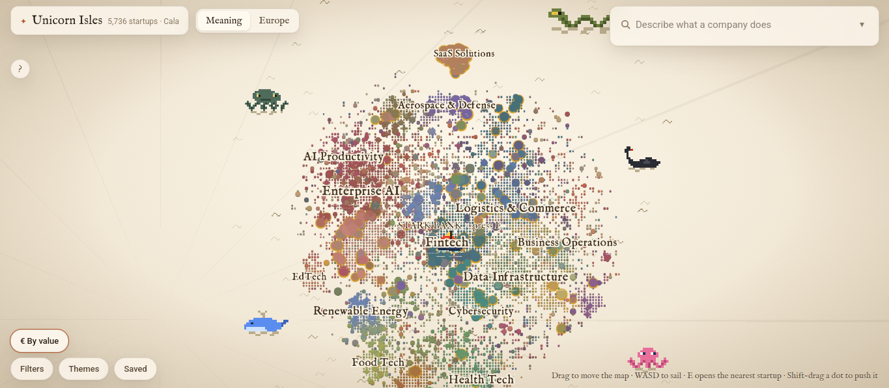

# Unicorn Isles



A pixel-art sea chart of 5,736 young startups. Sail it with WASD, ask it questions, leave with a shortlist. Built on Cala's knowledge graph.

- Live site: https://unicorn-isles.pages.dev (Cloudflare Pages: no server to wake up, files served from the nearest Cloudflare location)
- Challenge: Cala, "Make Unicorns Real", Junction 2026
- Built during Junction 2026 in Espoo, 13–15 November 2026.
- Fork of [johanseneuson/unicorn-isles](https://github.com/johanseneuson/unicorn-isles), with navigation and speed fixes and Cloudflare hosting.

## What it does
- **Europe view**: every country drawn in its real shape, made of its own startups (37 countries, 3,086 startups). Dot size is valuation.
- **Meaning view**: the same dots move next to the companies most like them (t-SNE over description embeddings, 22 themes).
- **Search**: describe a company in plain words; matches light up on the map.
- **Ask**: a full question goes to Cala's knowledge search (answer with sources); Gemma picks the matching startups. Needs `GEMINI_API_KEY` (and `CALA_API_KEY` for the Cala answer).
- **Startup card**: backers, closest competitors, stage, valuation, and where each fact came from.
- **Shortlist**: filter by stage, sector, funding or unicorn; save with F, export CSV, or sign in by email link to sync across devices.
- Sailing: WASD or the arrow keys move the boat, E opens the nearest startup, F saves it. On phones, a joystick and Open/Save buttons do the same. Eino and the sea creatures are there for fun.

### Keys
| Key | Does |
|---|---|
| WASD or arrows | Sail |
| E | Open the nearest startup |
| F | Save or unsave the open startup |
| + / - | Zoom in / out (or the mouse wheel) |
| 1 / 2 | Meaning view / Europe view |
| / | Jump to the search box |
| Esc | Close the startup card and the themes panel; in the search box, leave it |
| Shift + drag | Push a dot around (when zoomed in) |

## Run locally
Node 20+.
```
npm install
cp .env.example .env      # fill in the keys below (all optional: the map and search work without them)
npm run dev               # http://localhost:5180
```
The first search downloads the search model (about 34 MB) into `.cache/models/`; after that the server loads it at start.

## Deploy
### Cloudflare Pages (how the live site runs)
```
npx wrangler login                                                   # once
npx wrangler pages project create unicorn-isles --production-branch main   # once
npx wrangler pages secret put GEMINI_API_KEY --project-name unicorn-isles  # once per key; also CALA_API_KEY
npm run cf:deploy                                                    # build and upload
```
A new secret takes effect at the next `npm run cf:deploy`. The free plan is enough.

How it maps to Cloudflare:
- The built site is static files; `public/_headers` lets browsers cache the hashed files for a year.
- The `/api` routes are Pages Functions: `functions/api/[route].js` calls `cf/api.js`, which gives the same answers as the Node server routes.
- Search embeddings come from Workers AI (`@cf/baai/bge-small-en-v1.5`), the same model the map's vectors were made with: same #1 result and 22–23 of the top 24 on our test queries.
- `scripts/cf-data.mjs` (run by `npm run build:cf`) writes the data the functions read into `dist/_data/`: one file per startup, the vectors, and the Cala rounds and answers already cached in `.cache/`. Those files are not reachable from the web (`functions/_data`).
- New Cala results are kept in Cloudflare's cache instead of on disk.

Test the Cloudflare version locally with `npm run cf:dev` (http://localhost:8788). It needs the keys in a `.dev.vars` file (same format as `.env`, never committed) and, for search, a workers.dev subdomain on your Cloudflare account.

### Any Node host (Docker)
`npm run build && npx vite preview --host 0.0.0.0 --port $PORT` serves the site and the `/api` routes; the `Dockerfile` does this.

### Environment
| Name | Used for |
|---|---|
| `CALA_API_KEY` | Cala API: data import, Ask answers, funding rounds. Header `X-API-KEY`. Without it, only the rounds and answers already cached in `.cache/` show |
| `GEMINI_API_KEY` | Gemma (via the Gemini API): Ask picks and data gap filling. Server side only. Free key: https://aistudio.google.com/apikey |
| `VITE_SUPABASE_URL`, `VITE_SUPABASE_ANON_KEY` | Optional. Email-link sign-in and synced shortlists. Without them saves stay in the browser. Built into the page, so set them before building |

Locally the keys go in `.env`; on Cloudflare, `CALA_API_KEY` and `GEMINI_API_KEY` are Pages secrets (see Deploy). `.env` and `.dev.vars` are never committed.

Supabase setup: run `supabase/schema.sql`, then under Authentication > URL Configuration set the Site URL and add your app's URL to the redirect list. The committed `.env.production` points to the original project's Supabase; replace it with your own project to have sign-in work on your site.

## How it's built
- Vite, React, TypeScript, deck.gl. Pixel sprites are drawn in code (`src/v2/sprites.ts`).
- Server routes run inside Vite (`server/semantic.mjs`, `server/ask.mjs`), so API keys never reach the browser. On Cloudflare the same routes run as Pages Functions (`cf/api.js`).
- Search embeddings (bge-small) run locally with transformers.js, or on Workers AI on Cloudflare.
- The main app is `src/v2/`. The original Nordic island map is still there at `?classic`.

### Data pipeline
```
node scripts/import-world.mjs       # companies, funding and investors from Cala's entity graph (cached in .cache/)
node scripts/import-valuations.mjs  # latest valuations from Cala's knowledge query
node scripts/enrich-gemma.mjs       # fill gaps with Gemma; anything it fills is flagged as model-made
node scripts/atlas.mjs              # embeddings, meaning map, themes, logo sprite sheet
node scripts/relayout-world.mjs     # Europe map: country shapes from Natural Earth outlines
```
Kept: companies founded in 2020 or later. Dropped: acquired, listed and name-only records.

## Licence
MIT, see `LICENSE`. Data comes from Cala and is subject to Cala's terms.
